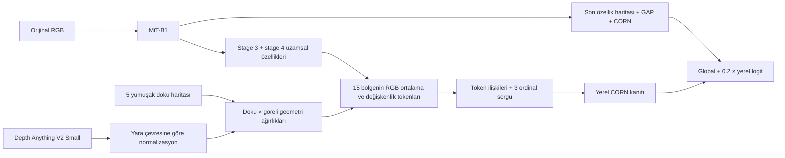

# Exp10 — Tissue × Relative Geometry Ordinal Tokens

**Durum:** Yeni mimari ve karşılaştırma hattı uygulanmıştır. Tam üç-fold
eğitim/test sonucu henüz yoktur; **81.68'in geçildiği iddia edilmemektedir.**
Depth, aynı RGB'den üretilen göreli ters-derinlik ön bilgisidir; fiziksel yara
derinliği, milimetre ölçümü veya bağımsız sensör verisi değildir.

## Deneylerden çıkan problem

Referans, Task 3'ün MiT-B1+CORN modelidir: üç-fold ortalama accuracy
**0.8168 ± 0.0150**, macro-F1 **0.8182 ± 0.0138**, QWK **0.9138 ± 0.0164**.
Kaynak: `task_3/results/task_3_outputs/results/ablation_summary.csv`.

Exp3 erken kanal füzyonu, exp4 iki kolun ortalama özelliklerinin füzyonu,
exp5/6 küçük logit düzeltmeleri, exp7 ortalaması alınmış ROI özellikleri
referansı geçemedi. Exp7'de gerçek/tüm-görüntü/karıştırılmış ROI arasında
**sıfır sınıf tahmini değişimi** vardı. Exp5'te doku değişimi düzeltmeyi
neredeyse değiştirmiyordu. Bunlar doku bilgisinin genel olarak yararsız
olduğunu göstermez; denenmiş ek kolların kullanılmadığını gösterir.

Exp6'da slough/granulation heterojenliği, ortalama doku oranından daha güçlü
evre ilişkisi gösterdi. Bu analiz keşifseldir; test fold'ları daha önce başka
deneylerde kullanıldığı için yeni doğrulama kümesi yerine geçmez.

## Önerilen mekanizma



1. **RGB bağlamı korunur.** Görüntü kırpılmaz veya maskelenmez. Stage 3
   `[320,14,14]` ve stage 4 `[512,7,7]` birlikte 96 kanala projekte edilir.
2. **Doku ve geometri birlikte bölge tanımlar.** Beş tahmini doku olasılığı,
   göreli ters-derinliğin üç yumuşak bölgesiyle kesişir: toplam 15 token.
   Bin merkezleri normalize koordinatta `[-1,0,+1]`'dir; klinik derinlik
   sınıfları değildir. Doku belirsizliği entropiyle ağırlıklandırılır;
   düşük güven tamamen silinmez, ağırlık tabanı 0.25'tir.
3. **Heterojenlik kaybolmaz.** Her token, bölgesindeki RGB özelliklerinin
   ağırlıklı ortalama ve standart sapmasını; bölge miktarını, göreli
   geometriyi, güveni ve uzamsal dağılımı taşır. Sabit tek bir doku
   severity skoru dayatılmaz.
4. **Evre sınırlarına ayrı sorgular vardır.** Üç öğrenilen sorgu, CORN'un
   üç koşullu kararına kanıt toplar. Doku/geometri kolunun kendi CORN
   kaybı vardır; çıktı ağırlıkları sıfır başlatılmaz. Böylece ilk geri
   yayılımda uzamsal kola gradyan ulaşır.
5. **RGB son katmanı birlikte uyarlanır.** MiT stage 1–3 donuktur ve eval
   modunda tutulur; stage 4 ile global başlık düşük öğrenme oranıyla
   eğitilir. Yeni dal daha yüksek öğrenme oranını kullanır.

Göreli geometri `g=(d-mean(d_rim))/std(d_wound+rim)` olarak hesaplanır;
pozitif ölçek ve kayma değişimlerine değişmezdir. Çevre halkası yoksa,
derinlik düz/geçersizse, geometri devreden çıkar ve doku moduna dönülür.
Yara bulunamazsa yerel çıktı tam sıfırdır ve model RGB çıktısına döner.
Yara yokluğundan elle bir evre atanmaz.

## Özgünlük sınırı ve önceki çalışmalar

RGB, doku, attention veya depth'i bir araya getirmek tek başına yenilik
değildir. Önerilen katkı adayı **doku × göreli geometri ile tanımlanan
uzamsal RGB dağılımlarını ordinal sınır sorgularına sunan özel mimaridir**.
Bu bir araştırma hipotezidir; ilk kez yapıldığına dair kapsamlı öncelik
iddiası kurulmamıştır.

- [Depth Anything V2, Yang et al.](https://arxiv.org/abs/2406.09414):
  göreli derinlik ön bilgisi; bu genel-sahne modeli yara boşluğu geometrisi
  için doğrulanmış değildir.
- [Resmî Depth Anything V2 kodu](https://github.com/DepthAnything/Depth-Anything-V2):
  ham float çıktı kullanılır; renkli/grayscale görselleştirme kullanılmaz.
- [Depth-aware CNN, ECCV 2018](https://www.ecva.net/papers/eccv_2018/papers_ECCV/html/Weiyue_Wang_Depth-aware_CNN_for_ECCV_2018_paper.php):
  derinliğe göre ağırlıklı convolution/pooling zaten vardır.
- [Bayraktar et al., 2026](https://pubmed.ncbi.nlm.nih.gov/42773341/):
  pressure ulcer staging için localization/global-local fusion/attention.
  Farklı bölünmedeki yayımlanmış sonuçlar bizim 81.68 ile doğrudan kıyaslanamaz.
- [Wajgi et al., 2026](https://link.springer.com/article/10.1007/s42452-026-08719-6):
  sensör derinliğiyle yara sınıflama ve çevre deri referanslı geometri.
- [Debnath et al., 2026](https://www.nature.com/articles/s41598-026-52864-2):
  yara analizi hattında MiDaS pseudo-depth; depth eklemenin kendisi yenilik değildir.

## Karşılaştırma tasarımı

| Mod | İçerik | Çözdüğü soru |
|---|---|---|
| `rgb` | Aynı başlangıç checkpoint'i, aynı stage 4/global başlık fine-tuning | Ek eğitim tek başına kazanım getiriyor mu? |
| `tissue` | RGB + doku tokenları; geometri yok | Uzamsal doku sinyali işe yarıyor mu? |
| `geometry` | RGB + yara desteği + geometri; beş doku kanalı eşitlenir | Doku bileşimi olmadan geometri işe yarıyor mu? |
| `full` | RGB + ortak doku × geometri tokenları | İkisinin etkileşimi ek katkı sağlıyor mu? |

`geometry`, doku haritalarının toplamından yara desteğini kullanır. Dolayısıyla
tamamen doku modelinden bağımsız bir "depth-only" deney değildir.
Değerlendirmedeki `fine_tuned_global`, ortak eğitilmiş modelin global koludur;
ayrıca eğitilmiş `rgb` kontrolünün yerine geçmez.

Bütün modlarda fold'lar Task 3'ten aynen alınır: seed=42, 3 fold,
val_fraction=0.1, 224px. `configs/baseline_protocol.json` gerçek tarihsel
checkpoint hash'lerini ve split hash'lerini sabitler; başka split altında
aynı checkpoint'lerin kullanılması reddedilir. Üyelik exp9'un mevcut
`features/index.csv` kaydıyla ayrıca karşılaştırılmıştır.

**Yeni eğitim protokolü** 50 epoch, patience=15, backbone LR=1e-5, yeni
başlık LR=3e-4, weight_decay=1e-4, yardımcı CORN ağırlığı=0.3'tür. Bu,
tarihsel RGB'nin 100 epoch protokolüyle aynı değildir. Dört yeni mod kendi
aralarında aynı seçme/eğitme protokolünü kullanır. İlk plan sabittir;
test skoruna göre hiperparametre araması yapılmamalıdır.

Tüm tahminler `task_3/src/metrics.py` içindeki **CORN ordinal median**
decoder'ını kullanır. `task_3/ensemble_eval.py` sınıf-olasılığı argmax
kullanır; bunlar farklı karar kurallarıdır. Eski bir yeniden ölçüm farkı
otomatik olarak MPS kayan nokta farkına bağlanmamalıdır.

## Çalıştırma

Komutlar repo kökünden çalıştırılır. Mevcut yerel Python ortamı
`task_1/.venv/bin/python` bütün gerekli paketleri içerir. Yeni GPU/Colab
ortamında önce `pip install -r more_experiments/exp/exp10_tissue_geometry_tokens/requirements.txt`.
`colab_train.ipynb` aynı akışı GPU için hazır hücrelerle sağlar.

### Colab için Drive'a yüklenecek dosyalar

Diğer deneylerdeki gibi üç ZIP'i **`MyDrive/thesis/`** klasörüne yükle:

| ZIP | Yerel dosya | ZIP içinde bulunması gerekenler |
|---|---|---|
| `wound-stage-classification.zip` | `datasets/wound-stage-classification.zip` (~16.2 MiB) | `wound-stage-classification/stage_1/` … `stage_4/`; toplam 1.091 orijinal RGB |
| `wound-staging-masks-exp-3.zip` | `datasets/wound-staging-masks-exp-3.zip` (~144.4 MiB) | `wound-staging-masks-exp-3/stage_1/` … `stage_4/`; toplam 1.091 RGB+5 doku `.npy` dosyası |
| `wound-stage-depth-anything-v2-small.zip` | `datasets/wound-stage-depth-anything-v2-small.zip` (~172.9 MiB) | `wound-stage-depth-anything-v2-small/stage_1/` … `stage_4/`; toplam 1.091 ham float32 depth `.npy` dosyası; aynı kökte **`manifest.json` ve `provenance.json`** |

Her ZIP, tablodaki isimli veri klasörünü içermelidir; yalnız başına
`stage_*` klasörlerini ZIP köküne koyma. Üç ZIP de yerelde hazırdır.

Üç tarihsel RGB checkpoint'i ayrıca mevcut Task 3 düzeninde bulunmalıdır:

```text
MyDrive/thesis/
├── wound-stage-classification.zip
├── wound-staging-masks-exp-3.zip
├── wound-stage-depth-anything-v2-small.zip
└── task_3_outputs/
    └── checkpoints/
        ├── mit_b1__corn_fold0.pt
        ├── mit_b1__corn_fold1.pt
        └── mit_b1__corn_fold2.pt
```

Bu üç `.pt` dosyasının yerel kaynağı
`task_3/results/task_3_outputs/checkpoints/` klasörüdür; ZIP olmaları gerekmez.
Notebook orijinal checkpoint'leri doğrular; eksik olanı yeniden eğiterek
değiştirmez. Task 1/2 checkpoint'lerine veya ayrıca bir depth model dosyasına
ihtiyaç yoktur; önceden üretilmiş haritalar ZIP'lerden okunur.

Notebook sırası exp3/5/7 ile aynıdır: Drive mount → repo clone/pull
(`/content/CanRollasThesisProject`) → ZIP'leri aç (`/content/data`) ve repo
içine bağla → bağımlılıklar → RGB checkpoint'lerini kopyala → kontroller →
çıktıları Drive'a yönlendir → eğitim → sonuçlar ve ablation.
Güncel exp10 kaynakları Step 2'de klonlanan GitHub reposunda bulunmalıdır.
Proje klasörünü bütünüyle Drive'a kopyalamak gerekmez.
Çıktılar **`MyDrive/thesis/exp10_tissue_geometry_tokens_outputs/`** altında
tutulur. Kesintiden sonra ilgili fold'un resume dosyası varsa otomatik
olarak `--resume` ile devam edilir.

Gerekli girdiler: orijinal staging RGB'leri, exp3'ün 8-kanallı `.npy`
cache'i ve Task 3 MiT-B1+CORN üç checkpoint'i. RGB, orijinal JPEG'den
okunur; cache RGB'siyle piksel eşitliği kontrol edilir. Bütün haritalara
aynı flip/90° dönüş uygulanır.

```bash
# Yerel cached Small ağırlıklarıyla ham göreli depth üretimi.
task_1/.venv/bin/python more_experiments/exp/exp10_tissue_geometry_tokens/scripts/prepare_depth.py
# Yeni ortamda public model indirmek için aynı komuta --allow-download ekle.

# Cache'i değiştirmeden bütün source/output hash'lerini doğrula.
task_1/.venv/bin/python more_experiments/exp/exp10_tissue_geometry_tokens/scripts/prepare_depth.py --verify-only

# Kısa uçtan uca kontrol: 8 train + 8 val; test açılmaz.
task_1/.venv/bin/python more_experiments/exp/exp10_tissue_geometry_tokens/scripts/train.py --mode full --smoke

# Gerçek eğitim: dört mod, aynı üç fold ve eğitim seed'i.
for mode in rgb tissue geometry full; do
  task_1/.venv/bin/python more_experiments/exp/exp10_tissue_geometry_tokens/scripts/train.py --mode "$mode"
done
```

Her mod checkpoint'lerini `runs/main/seed42/<mode>/` içine yazar. Eğitim
yalnız train/validation verisini modelden geçirir; test yalnız sonradan
ayrı komutla açılır. Yarım kalan eğitime aynı komutla `--resume` eklenir.
Tamamlanmış/early-stop olmuş eğitim tekrar ek epoch çalıştırmaz. Yapılandırma,
kod, veri byte'ları ve checkpoint değişmişse resume reddedilir. CPU/CUDA/MPS
RNG durumları kaydedilir; farklı donanımlar arasında bit düzeyinde eşitlik
vaat edilmez.

```bash
# Önce validation tanıları; run-dir'yi ilgili moda göre değiştir.
task_1/.venv/bin/python more_experiments/exp/exp10_tissue_geometry_tokens/scripts/evaluate.py \
  --run-dir more_experiments/exp/exp10_tissue_geometry_tokens/runs/main/seed42/full

# Tasarım ve seçim kilitlendikten sonra aynı değerlendirmeyi testte yap.
task_1/.venv/bin/python more_experiments/exp/exp10_tissue_geometry_tokens/scripts/evaluate.py \
  --run-dir more_experiments/exp/exp10_tissue_geometry_tokens/runs/main/seed42/full --split test

task_1/.venv/bin/python -m unittest discover \
  -s more_experiments/exp/exp10_tissue_geometry_tokens/scripts -p 'test_*.py' -v
```

Değerlendirmeyi ayrıca `rgb`, `tissue`, `geometry` eğitimleri için çalıştır.
Çıktı `metrics.json` ve görüntü bazında `predictions.csv` içerir. Gerçek,
sıfır doku, eşitlenmiş doku, karıştırılmış doku, düz depth, karıştırılmış
depth ve birlikte karıştırılmış ön bilgiler ölçülür. Karıştırma batch
boyutundan bağımsız sabit bir derangement'tır; görüntü kendisiyle eşleşmez.
Hem logit değişimi hem sınıf değişimi raporlanır. Bozuk girişte performans
düşmesi tek başına yararlı/klinik olarak doğru kullanım kanıtı değildir.

Dört ayrı eğitimi aynı tabloda ve eşleştirilmiş olarak karşılaştırmak için:

```bash
task_1/.venv/bin/python more_experiments/exp/exp10_tissue_geometry_tokens/scripts/compare_runs.py \
  --root more_experiments/exp/exp10_tissue_geometry_tokens/runs/main/seed42 \
  --split test --output-dir more_experiments/exp/exp10_tissue_geometry_tokens/runs/main/seed42/comparison_test
```

Karşılaştırma eksik kontrol, farklı görüntü üyeliği veya uyuşmayan başlangıç
referansını kabul etmez. Aynı komut `--split val` ile seçim öncesi tanılar
için de kullanılabilir.

## Başarı ölçütü ve mevcut doğrulama

Başarı: `full` modelinin tam üç-fold test ortalamasında tarihsel **0.8168**
ve yeniden ölçülen orijinal RGB'yi geçmesi; ayrıca aynı eğitimli `rgb`
kontrolüne göre artımlı kazanım göstermesi. Macro-F1, QWK, stage3/4
karışıklığı, düzeltilen/bozulan görüntüler ve fold tutarlılığı birlikte
raporlanır. Üç fold tamamlanmadan tek fold sonucu genel başarı diye sunulmaz.
İlk olumlu sonuç sonrasında farklı eğitim seed'leri ve mümkünse yeni,
hastaya göre ayrılmış bir dış test kümesiyle doğrulama gerekir.

Testte eşleştirilmiş McNemar ve fold içinde görüntü bootstrap'i raporlanır;
bunlar hasta düzeyinde istatistik değildir. Validation'da görüntüler fold'lar
arasında tekrarlanabildiği için havuzlanmış p-değeri/CI üretilmez. Mevcut
split görüntü düzeyindedir; hasta bağımsızlığı kanıtlanmamıştır. Görevler
arası dosya/UUID overlap denetimi de hasta bağımsızlığı kanıtı sayılmaz.

Uygulama kontrolleri: ilk adımdaki gradyanlar; gerçek Task 3 checkpoint'i
ile global yolun tam eşitliği; doku düzenine ve geometriye duyarlılık;
pozitif affine depth dönüşümüne değişmezlik; boş yara ve geçersiz geometri
fallback'i; veri hizalama; karıştırmanın kendine eşleşmemesi ve cache
değişiminin tespit edilmesi. Kısa smoke skorları model başarımı değildir.
