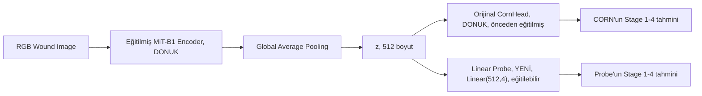

# Exp11 — Linear Probing: CORN'un Hatalarını Teşhis Etme

**Durum (28 Ekim 2026):** Üç fold'un üçü de uçtan uca çalıştırıldı
(özellik çıkarımı → probe eğitimi → hata karşılaştırması → 3-fold
toplulaştırma). Gerçek sayılar aşağıda. Hiçbir fold'da test split'i
model seçimi için kullanılmadı; `C` her fold'da yalnızca kendi validation
split'iyle seçildi.

## Soru

task_3'ün mevcut MiT-B1+CORN modelini **yeniden eğitmeden**: encoder,
CORN'un yanlış sınıflandırdığı yaraları doğru ayırabilecek bilgiyi
zaten öğrenmiş mi? Yoksa bu bilgi encoder'da hiç yok mu?

Bunu, CORN'un kendi kararını değiştirmeden, aynı donmuş özellik
vektörünün üzerine farklı bir doğrusal karar kuralı (linear probe)
koyarak test ediyoruz.

## Mimari



İki model de aynı `z` vektörünü okuyor. Değişen yalnızca karar
mekanizması. `task_3/src/model.py`'nin `Backbone.forward`'ı bu havuzlamayı
zaten yapıyor (`last_feature_map.mean(dim=(2,3))`); bu deney encoder'ı
veya onun ağırlıklarını hiçbir şekilde değiştirmiyor.

## Kritik bir düzeltme: "penultimate CORN özelliği" diye bir şey yok

Öneri, probe'u iki seviyede eğitmeyi önerdi: "final encoder features" ve
"CORN head'inin son logit katmanından hemen önceki özellikler (head'de
böyle bir ara katman varsa)". `task_3/src/model.py`'de doğrudan kontrol
edildi: **`CornHead` tek bir `Linear(in_dim, num_classes-1)` katmanıdır,
ara katmanı yoktur.** Yani "final encoder features" ile "CORN'un
son logit katmanından önceki özellikler" **birebir aynı vektördür** --
ayrı bir ikinci seviye yok.

Bunun yerine ikinci seviye olarak **stage3 özelliklerini** (MiT-B1'in
son katmanından ÖNCEKİ aşama, `[B,320,14,14]` → GAP → 320 boyut)
kullanıyoruz. Bu, "bilgi ağ içinde bir yerde kaybolmuş mu" sorusunu daha
erken bir noktada soruyor -- önerinin ruhuna uygun bir ikame, ama
"final vs. pre-logit" değil, "final-stage vs. earlier-stage" karşılaştırması.
`scripts/extract_features.py`'nin docstring'i bunu ayrıca belgeliyor.

## Adımlar ve kod

1. **`scripts/extract_features.py --fold F`** -- task_3'ün gerçek
   `mit_b1__corn_fold{F}.pt` checkpoint'ini yükler, encoder+head'i
   `eval()` modunda donuk tutar, train/val/test'teki her görüntü için
   `final_features` (512), `stage3_features` (320), `labels`,
   **CORN'un kendi tahminini** (`corn_preds` -- aynı forward pass'te,
   gerçek checkpoint'ten, ayrıca saklanmış bir özetten değil) ve `ids`
   kaydeder. Çıkış: `results/fold_{F}/{split}_*.npy`.

   Dahili doğrulama: test split'teki `corn_acc`, task_3'ün kendi
   `ablation_results.csv`'sindeki aynı fold'un sayısıyla **4 ondalık
   basamağa kadar eşleşmeli** (aynı checkpoint, aynı split, aynı decode
   kuralı) -- fold 0'da doğrulandı: **0.8122 == 0.8122**.

2. **`scripts/train_probe.py --fold F --level {final,stage3}`** --
   `sklearn.linear_model.LogisticRegression` (öneri bunu "daha temiz"
   diye önerdi). `StandardScaler` yalnızca train'e fit edilir;
   regularization (`C`) validation macro-F1 ile 6 noktalı bir
   ızgarada seçilir; test split'e **yalnızca `C` sabitlendikten sonra,
   tek seferde** dokunulur.

3. **`scripts/compare_errors.py --fold F --level {final,stage3}`** --
   test split'te CORN'un ve probe'un tahminlerini birleştirir, 4 gruba
   ayırır (ikisi de doğru / probe'un kurtardığı / probe'un bozduğu /
   ikisi de yanlış), CORN'un her (gerçek, tahmin) hata çiftinde
   probe'un kurtarma oranını raporlar (Stage3→Stage4 ayrıca işaretli,
   ama tüm çiftler raporlanıyor, sadece o değil), ve görüntü bazlı tam
   döküm (`compare_{level}_per_image.csv`) yazar.

## Sonuçlar -- üç fold, gerçek (ortalama ± std; std popülasyon std'si,
`task_3/src/utils.py`'nin `write_summary`'siyle aynı kural)

Her fold'un `test corn_acc`'ı, dahili sanity check'te task_3'ün kendi
`ablation_results.csv`'sine 4 ondalık basamağa kadar eşleşti (fold0
0.8122, fold1 0.8370, fold2 0.8011) -- CORN satırının ortalama±std'si bu
yüzden task_3'ün yayınlanmış baseline sayısıyla (0.8168±0.0150 /
0.8182±0.0138 / 0.9138±0.0164) birebir aynı, ayrı bir şey değil.

### Accuracy / Macro-F1 / MAE / QWK

| Model | Accuracy | Macro-F1 | MAE | QWK |
|---|---|---|---|---|
| **CORN** (referans, değiştirilmedi) | 0.8168 ± 0.0150 | 0.8182 ± 0.0138 | 0.1896 ± 0.0204 | 0.9138 ± 0.0164 |
| **Probe, `final`** (512d, CornHead'in okuduğu) | 0.8103 ± 0.0111 | 0.8122 ± 0.0113 | 0.1952 ± 0.0153 | 0.9125 ± 0.0101 |
| **Probe, `stage3`** (320d, kontrol) | 0.7709 ± 0.0198 | 0.7725 ± 0.0199 | 0.2355 ± 0.0202 | 0.8920 ± 0.0078 |

`final` probu CORN'a çok yakın (fark <0.01 her metrikte, kendi std'si
içinde); `stage3` probu her metrikte anlamlı şekilde daha kötü.

### Hata kırılımı, 3 fold toplamında (200 CORN hatası = 68+59+73)

| Seviye | Kurtarılan | Yeni oluşan hata | Ortak kalan | / CORN hatası | Havuzlanmış kurtarma oranı |
|---|---|---|---|---|---|
| `final` | **29** | 36 | 171 | 200 | **%14.5** |
| `stage3` | **50** | 100 | 150 | 200 | **%25.0** |

Fold bazında (final / stage3, kurtarılan-yeni oluşan-ortak):

| Fold | CORN hata sayısı | `final`: kurtarılan / yeni hata / ortak | `stage3`: kurtarılan / yeni hata / ortak |
|---|---|---|---|
| 0 | 68 | 6 / 9 / 62 | 14 / 32 / 54 |
| 1 | 59 | 9 / 13 / 50 | 16 / 30 / 43 |
| 2 | 73 | 14 / 14 / 59 | 20 / 38 / 53 |

`stage3` üç fold'un **üçünde de** `final`'den daha fazla hata kurtarıyor,
ama her fold'da aynı zamanda çok daha fazla "yeni hata" yaratıyor (doğru
bildiği CORN tahminini bozuyor) -- bu tutarlı örüntü, fold0'da görülenin
gürültü olmadığını, üç fold'da da aynı yönde tekrarlandığını gösteriyor.

### true=stage_3, CORN-predicted=stage_4 hücresi -- 3 fold toplamında

| Fold | n (bu hücredeki CORN hatası) | `final` kurtarılan | `stage3` kurtarılan |
|---|---|---|---|
| 0 | 28 | 4 (%14.3) | 6 (%21.4) |
| 1 | 21 | 6 (%28.6) | 7 (%33.3) |
| 2 | 16 | 0 (%0.0) | 6 (%37.5) |
| **Toplam** | **65** | **10 (%15.4)** | **19 (%29.2)** |

Bu hücredeki kurtarma oranı fold2'de `final` seviyesinde **sıfır** --
fold2'de bu sınırda CORN'un yanıldığı 16 görüntünün hiçbirini `final`
probu düzeltemiyor (aynı fold'da `stage3` 6'sını düzeltiyor). Fold'lar
arasında büyük değişkenlik var; "Stage3→4 sınırında encoder'da tutarlı
bir ek sinyal var" iddiası tek bir fold'a dayanıp genellenemez.

## Yorum (üç fold, hâlâ tek bir probe tasarımı)

Öneri'nin kendi yorum tablosundaki "**probe çok benzer hatalar
yapıyor**" satırına en yakın kalıyor: `final` seviyesinde havuzlanmış
kurtarma oranı düşük (%14.5), CORN'un hatalarının %85.5'i probe için de
hata. Ama sıfır değil -- 29 gerçek kurtarma, üç fold'un üçünde de
tutarlı şekilde gerçekleşiyor (6/9/14), rastgele bir fold'a özgü değil.

`stage3` (daha erken, daha az işlenmiş temsil) her üç fold'da da genel
doğrulukta daha kötü ama CORN'un **kendi** hatalarını kurtarmada daha
iyi (%25.0 vs %14.5) -- bedeli, doğru bilinen tahminleri bozma oranının
da artması (100 vs 36 yeni hata). Bu, "genel doğruluk" ile "CORN'un
spesifik hatalarını düzeltme kapasitesi"nin aynı eksen olmadığını üç
fold boyunca tutarlı şekilde gösteriyor -- fold0'daki gözlem bir
tesadüf değildi.

**Sonuç:** CORN'un okuduğu 512-boyutlu temsilde doğrusal olarak
ayrıştırılabilen, CORN'un kullanmadığı gerçek ama sınırlı bir ek bilgi
var (üç fold'da toplam 29 tutarlı kurtarma) -- bu, encoder'ın "yetersiz"
olduğu anlamına gelmez, CORN'un zaten kullandığı bilgiye yakın bir
temsil okuyor olmasına işaret eder. Daha erken katmanlardaki bilgi
(`stage3`) CORN'un hatalarına göre biraz daha tamamlayıcı görünüyor, ama
bunu doğrudan bir mimari değişikliğe çevirmek (örn. stage3'ü head'e
eklemek) bu deneyin kapsamında değil ve ayrı bir doğrulama gerektirir --
tek bir linear probe sonucu, mimari bir değişikliği otomatik olarak
haklı çıkarmaz.

## Çalıştırma

```bash
for fold in 0 1 2; do
  task_1/.venv/bin/python more_experiments/exp/exp11_linear_probe/scripts/extract_features.py --fold "$fold"
  for level in final stage3; do
    task_1/.venv/bin/python more_experiments/exp/exp11_linear_probe/scripts/train_probe.py --fold "$fold" --level "$level"
    task_1/.venv/bin/python more_experiments/exp/exp11_linear_probe/scripts/compare_errors.py --fold "$fold" --level "$level"
  done
done

# Üç fold tamamlandıktan sonra tek seferlik toplulaştırma:
task_1/.venv/bin/python more_experiments/exp/exp11_linear_probe/scripts/aggregate_results.py
```

Tamamen CPU'da çalışır (GPU/Colab gerekmiyor) -- hiçbir adımda encoder'a
geri yayılım yok, yalnızca donuk forward pass + `sklearn` üzerinde ufak
bir doğrusal fit. `scripts/` hiçbir dosyayı fold'a özel olmayan bir yere
yazmıyor (`results/fold_{F}/` altında ayrışık); `aggregate_results.py`
diskte zaten var olan özetleri okur, hiçbir şeyi yeniden hesaplamaz veya
test split'ine yeniden dokunmaz. Çıkış: `results/aggregate_summary.{json,csv}`.
