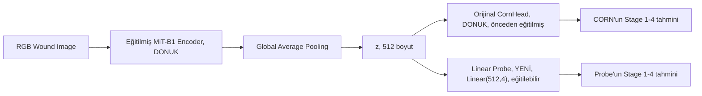

# Exp11 — Linear Probing: CORN'un Hatalarını Teşhis Etme

**Durum (28 Ekim 2026):** Fold 0 üzerinde uçtan uca çalıştırıldı (özellik
çıkarımı → probe eğitimi → hata karşılaştırması). Gerçek sayılar aşağıda.
**Fold 1 ve Fold 2 henüz çalıştırılmadı.**

## Soru

task_3'ün mevcut MiT-B1+CORN modelini **yeniden eğitmeden**: encoder,
CORN'un yanlış sınıflandırdığı yaraları doğru ayırabilecek bilgiyi
zaten öğrenmiş mi? Yoksa bu bilgi encoder'da hiç yok mu?

Bunu, CORN'un kendi kararını değiştirmeden, aynı donmuş özellik
vektörünün üzerine farklı bir doğrusal karar kuralı (linear probe)
koyarak test ediyoruz.

## Mimari



İki model de aynı `z` vektörünü okuyor. Değişen yalnızca karar
mekanizması. `task_3/src/model.py`'nin `Backbone.forward`'ı bu havuzlamayı
zaten yapıyor (`last_feature_map.mean(dim=(2,3))`); bu deney encoder'ı
veya onun ağırlıklarını hiçbir şekilde değiştirmiyor.

## Kritik bir düzeltme: "penultimate CORN özelliği" diye bir şey yok

Öneri, probe'u iki seviyede eğitmeyi önerdi: "final encoder features" ve
"CORN head'inin son logit katmanından hemen önceki özellikler (head'de
böyle bir ara katman varsa)". `task_3/src/model.py`'de doğrudan kontrol
edildi: **`CornHead` tek bir `Linear(in_dim, num_classes-1)` katmanıdır,
ara katmanı yoktur.** Yani "final encoder features" ile "CORN'un
son logit katmanından önceki özellikler" **birebir aynı vektördür** --
ayrı bir ikinci seviye yok.

Bunun yerine ikinci seviye olarak **stage3 özelliklerini** (MiT-B1'in
son katmanından ÖNCEKİ aşama, `[B,320,14,14]` → GAP → 320 boyut)
kullanıyoruz. Bu, "bilgi ağ içinde bir yerde kaybolmuş mu" sorusunu daha
erken bir noktada soruyor -- önerinin ruhuna uygun bir ikame, ama
"final vs. pre-logit" değil, "final-stage vs. earlier-stage" karşılaştırması.
`scripts/extract_features.py`'nin docstring'i bunu ayrıca belgeliyor.

## Adımlar ve kod

1. **`scripts/extract_features.py --fold F`** -- task_3'ün gerçek
   `mit_b1__corn_fold{F}.pt` checkpoint'ini yükler, encoder+head'i
   `eval()` modunda donuk tutar, train/val/test'teki her görüntü için
   `final_features` (512), `stage3_features` (320), `labels`,
   **CORN'un kendi tahminini** (`corn_preds` -- aynı forward pass'te,
   gerçek checkpoint'ten, ayrıca saklanmış bir özetten değil) ve `ids`
   kaydeder. Çıkış: `results/fold_{F}/{split}_*.npy`.

   Dahili doğrulama: test split'teki `corn_acc`, task_3'ün kendi
   `ablation_results.csv`'sindeki aynı fold'un sayısıyla **4 ondalık
   basamağa kadar eşleşmeli** (aynı checkpoint, aynı split, aynı decode
   kuralı) -- fold 0'da doğrulandı: **0.8122 == 0.8122**.

2. **`scripts/train_probe.py --fold F --level {final,stage3}`** --
   `sklearn.linear_model.LogisticRegression` (öneri bunu "daha temiz"
   diye önerdi). `StandardScaler` yalnızca train'e fit edilir;
   regularization (`C`) validation macro-F1 ile 6 noktalı bir
   ızgarada seçilir; test split'e **yalnızca `C` sabitlendikten sonra,
   tek seferde** dokunulur.

3. **`scripts/compare_errors.py --fold F --level {final,stage3}`** --
   test split'te CORN'un ve probe'un tahminlerini birleştirir, 4 gruba
   ayırır (ikisi de doğru / probe'un kurtardığı / probe'un bozduğu /
   ikisi de yanlış), CORN'un her (gerçek, tahmin) hata çiftinde
   probe'un kurtarma oranını raporlar (Stage3→Stage4 ayrıca işaretli,
   ama tüm çiftler raporlanıyor, sadece o değil), ve görüntü bazlı tam
   döküm (`compare_{level}_per_image.csv`) yazar.

## Fold 0 sonuçları (gerçek, 362 test görüntüsü)

### `final` seviyesi (CornHead'in okuduğu aynı 512-boyutlu vektör)

| | |
|---|---|
| CORN accuracy | 0.8122 |
| Probe accuracy | 0.8039 |
| İkisi de doğru | 285 |
| **Probe'un kurtardığı** (CORN yanlış, probe doğru) | **6** |
| Probe'un bozduğu (CORN doğru, probe yanlış) | 9 |
| İkisi de yanlış | 62 |
| CORN hata sayısı | **68** |
| Kurtarma oranı | **%8.8** |
| Ortak hata oranı | %91.2 |

En sık hata çifti, `true=stage_3, corn_pred=stage_4`, **n=28** (CORN'un
68 hatasının %41'i) -- probe bunların **4'ünü** (%14.3) doğru stage_3
olarak düzeltiyor.

### `stage3` seviyesi (kontrol: daha erken, daha az işlenmiş özellik)

| | |
|---|---|
| CORN accuracy | 0.8122 |
| Probe accuracy | 0.7624 (daha düşük) |
| Probe'un kurtardığı | **14** (final'den daha fazla) |
| Probe'un bozduğu | 32 (final'den çok daha fazla) |
| Kurtarma oranı | **%20.6** (final'in %8.8'inden yüksek) |

`stage3`'ün genel doğruluğu daha düşük olsa da, CORN'un **kendi
hatalarını** kurtarma oranı daha yüksek (%20.6 vs %8.8) -- ama bunun
bedeli çok daha fazla "bozma" (32 vs 9). Bu, genel doğruluk ile "CORN'un
spesifik hatalarını düzeltme kapasitesi"nin aynı şey olmadığını
gösteriyor; tek bir fold'da bu farkın gürültü mü gerçek bir örüntü mü
olduğu belirlenemez.

## Yorum (fold 0, tek fold, kesin değil)

Öneri'nin kendi yorum tablosuna göre bu "**probe çok benzer hatalar
yapıyor**" satırına en yakın: `final` seviyesinde kurtarma oranı düşük
(%8.8), ortak hata oranı yüksek (%91.2) -- **doğrusal olarak
ayrıştırılabilen ek bilginin sınırlı olduğu** ihtimali güçleniyor, ama
sıfır değil (6 gerçek kurtarma var, rastgele değil -- hepsi CORN'un
belirsiz kaldığı görüntüler). Stage3→Stage4 hücresinde kurtarma oranı
(%14.3) genel kurtarma oranından (%8.8) yüksek -- bu spesifik sınır
belirsizliğinde encoder'ın az da olsa kullanılabilir ek sinyali olduğuna
işaret ediyor, ama n=28 küçük bir örneklem.

**Tek fold'dan "encoder yeterli/yetersiz" diye kesin bir sonuç
çıkarılamaz** -- önerinin kendi uyarısı burada da geçerli. Sıradaki adım
aynı prosedürü Fold 1 ve Fold 2'ye uygulamak.

## Çalıştırma

```bash
task_1/.venv/bin/python more_experiments/exp/exp11_linear_probe/scripts/extract_features.py --fold 0
task_1/.venv/bin/python more_experiments/exp/exp11_linear_probe/scripts/train_probe.py --fold 0 --level final
task_1/.venv/bin/python more_experiments/exp/exp11_linear_probe/scripts/train_probe.py --fold 0 --level stage3
task_1/.venv/bin/python more_experiments/exp/exp11_linear_probe/scripts/compare_errors.py --fold 0 --level final
task_1/.venv/bin/python more_experiments/exp/exp11_linear_probe/scripts/compare_errors.py --fold 0 --level stage3
```

Tamamen CPU'da çalışır (GPU/Colab gerekmiyor) -- hiçbir adımda encoder'a
geri yayılım yok, yalnızca donuk forward pass + `sklearn` üzerinde ufak
bir doğrusal fit. Fold 1/2 için `--fold 1` / `--fold 2` ile aynı üç
komutu tekrarla; `scripts/` hiçbir dosyayı fold'a özel olmayan bir yere
yazmıyor (`results/fold_{F}/` altında ayrışık).
