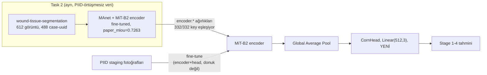

# Exp12 — Segmentasyon ile Ön-Eğitilmiş Encoder'dan Transfer

**Durum (30 Ekim 2026):** Mimari ve kod hazır, local'de doğrulandı (bkz.
"Mimari doğrulama"). **Henüz Colab'da eğitilmedi** — aşağıdaki sonuç
tablosu placeholder.

## Soru

task_3'ün fusion denemelerinde (exp4/5/6/7/9) doku bilgisi hep ikinci bir
dal olarak eklendi ve güçlü RGB dalı karşısında sistematik olarak zayıf
kaldı (exp5/6/7'nin tanı sonuçları: eklenen dal ya neredeyse sıfır
içerik-bağımlılığı gösterdi ya da hiçbir tahmini değiştirmedi). Bu deney
farklı bir yol deniyor: doku bilgisini ayrı bir dal olarak **eklemek**
yerine, encoder'ın **kendisini** dokuyu zaten ayırt eden bir başlangıç
noktasından başlatmak.

task_2'nin segmentasyon-benchmark grid'inde (`task_2/configs/base.yaml`)
MAnet+MiT-B2 en iyi performanslı konfigürasyon (`paper_miou=0.7263`,
5 doku sınıfı: granulation, slough, necrosis, tendon, bone). Bu encoder
piksel seviyesinde dokuyu ayırmayı zaten öğrenmiş durumda. Soru: bu
encoder'ın decoder'ını atıp CORN head ekleyip PIID evreleme verisinde
fine-tune edersek, ImageNet-init aynı encoder'a göre bir kazanç var mı?

## Mimari



Bu, task_3'ün kendi `build_model("mit_b2", weights, "corn")`'u ile
**mimari olarak birebir aynı** (`scripts/model.py` bunu doğrudan
`task_3/src/model.py`'nin `Backbone`/`CornHead`'inden kurar) — tek fark
encoder ağırlıklarının nereden geldiği. exp10'un donuk-backbone +
residual-head tasarımının aksine burada **dondurma yok**: bu bir ağırlık
başlatma (weight-init) deneyi, task_3'ün ablation grid'indeki her diğer
konfigürasyon gibi encoder+head birlikte tam fine-tune ediliyor.

## Mimari doğrulama

`smp.MAnet`'in `encoder.*` state-dict key'leri, task_3'ün `Backbone`'unun
`encoder` alt-modülüyle **isim ve şekil olarak birebir aynı** — ikisi de
aynı `smp.encoders.get_encoder("mit_b2", ...)` çağrısını sarıyor. Local'de
doğrulandı (`scripts/test_model.py`, task_1/.venv ile):

```
[PASS] all encoder.* keys present and shape-matched (332/332)
[PASS] encoder weights changed from random init after load
[PASS] CORN logits shape == [4, 3] (batch=4, num_classes-1=3)
```

`backbone.encoder.load_state_dict(...)` → `<All keys matched
successfully>`. Yanlışlıkla partial/sessiz bir yükleme olmadığından emin
olmak için `scripts/train.py` her fold'da bu sayıları yazdırır ve
`checkpoint_encoder_keys == backbone_encoder_keys` ile
`weights_changed_from_init` tutmazsa eğitime başlamadan durur.

## Adil kontrol tasarımı

Önerinin kendi uyarısı doğru: büyük encoder'dan gelen bir kazanç
görülürse, bunun "task_2'den gelen doku bilgisinden mi yoksa sadece daha
büyük bir encoder'dan mı" kaynaklandığı ayrıştırılmalı. Üç satırlı bir
karşılaştırma kuruldu:

| Config | Encoder | Ağırlık | Durum |
|---|---|---|---|
| `mit_b1__corn` | MiT-B1 | ImageNet | task_3'ün kendi ablation grid'inde **zaten var**, yeniden eğitilmiyor — model-boyutu referansı |
| `mit_b2__corn` | MiT-B2 | ImageNet | task_3'ün kendi ablation grid'inde **zaten var**, yeniden eğitilmiyor — adil büyüklük kontrolü |
| `mit_b2_task2init__corn` | MiT-B2 | task_2 MAnet encoder | **Bu deney** |

**Bulgu (plan sırasında, eğitim öncesi):** `mit_b2__corn` (ImageNet)
zaten task_3'ün sonuç CSV'sinde: **acc 0.7854±0.0247, macro_f1
0.7860±0.0256, mae 0.2210±0.0244, qwk 0.9019±0.0099** (3 fold,
`task_3/results/task_3_outputs/results/ablation_results.csv` satır
65-67). Yani önerilen "ImageNet-init MiT-B2 + CORN'u da aynı split'te
koş" kontrolü **zaten mevcut** — tekrar eğitmeye gerek yok, iki eğitim
koşusu tasarruf edildi. Ayrıca dikkat çekici: ImageNet MiT-B2, MiT-B1'den
(0.8168) **daha kötü** — bu veri boyutunda (1091 görüntü) daha büyük
encoder dezavantajlı. Task2-init'in bu açığı kapatıp kapatmadığı asıl
soru.

## Leakage

task_2'nin 612 doku-segmentasyon görüntüsü, 488 benzersiz `case-uuid`'den
geliyor (`ft_tendonbone_<uuid>` — task_1'in klinik foto alt kümesiyle
1:1 örtüşüyor, yani task_1 ve task_2 kaynak fotoğraf paylaşıyor), ama
**PIID evreleme veri setiyle (task_3'ün eğitim verisi) hiçbir örtüşme
yok** — `more_experiments/manifests/piid_overlap_report.json`'un
`task2_piid_overlap_check` alanında doğrulanmış:

> "No PIID/evre/stage-pattern filenames found in
> datasets/wound-tissue-segmentation/tissue_images/ ... No
> Task-2-to-Task-3 leakage risk found."

## Fold ↔ task_2-checkpoint eşleşmesi

task_2'nin kendi 3-fold CV'si (`wound_inner_fold1/2/3`) **tamamen farklı
bir veri setini** (doku segmentasyonu) böldüğü için, task_3'ün fold'larıyla
(PIID evreleme) hiçbir doğal karşılığı yok. Eşleşme keyfi ama sabit:
task_3 fold `f` (0/1/2) → task_2'nin `wound_inner_fold{f+1}` encoder'ı.
Bu seçim leakage açısından önemsiz (iki veri seti arasında zaten hiç
ortak PIID yok, hangi task_2 fold'u kullanılırsa kullanılsın), ama
task_2'nin 3 bağımsız eğitilmiş encoder snapshot'ının her biri tam
olarak bir kez kullanılmış oluyor (her zaman aynısını tekrar kullanmak
yerine).

## Eğitim tarifi

`scripts/train.py`, hiper-parametreleri **kendi config'inde tekrar
etmiyor** — `task_3/configs/base.yaml`'ı doğrudan okuyor (lr, epochs,
batch, image_size, augment, fold/seed). Bu, `mit_b2__corn` (ImageNet)
satırlarıyla byte-seviyesinde aynı tarif kullanıldığını garanti ediyor;
iki satır arasındaki tek fark encoder ağırlıklarının kaynağı.

## Çalıştırma

```bash
# local sanity check (GPU gerekmez, task_2 checkpoint'leri diskte olmalı)
task_1/.venv/bin/python3 more_experiments/exp/exp12_segmentation_pretrained_transfer/scripts/test_model.py

# Colab'da gerçek eğitim: colab_train.ipynb (mount Drive -> clone -> dataset
# -> task_2 checkpoint'lerini Drive'dan çek -> sanity check -> train.py
# (3 fold) -> compare_results.py)
```

```bash
# sonradan, local veya Colab'da, sonuç karşılaştırması:
task_1/.venv/bin/python3 more_experiments/exp/exp12_segmentation_pretrained_transfer/scripts/compare_results.py
```

Kesintiye uğrarsa güvenle yeniden çalıştırılabilir — `train.py` zaten
tamamlanmış `(config_id, fold)` satırlarını atlar (task_3/run_ablation.py
ile aynı kural).

## Sonuçlar

*(Henüz çalıştırılmadı — Colab'da 3 fold tamamlandıktan sonra
`compare_results.py` çıktısı buraya eklenecek.)*
