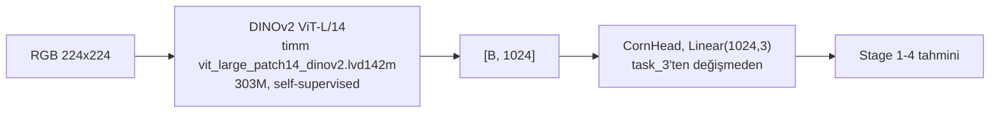

# Exp13 — DINOv2 ViT-L/14 Encoder

**Durum (30 Ekim 2026):** Mimari ve kod hazır, local'de **ağırlık
indirmeden** doğrulandı (`pretrained=False`, bkz. "Mimari doğrulama").
**Henüz hiçbir fold, hiçbir modda eğitilmedi** — aşağıdaki sonuç tablosu
placeholder. Gerçek ağırlık indirme (~1.2GB) ve eğitim Colab'da yapılacak.

## Soru

exp12 "aynı boyut sınıfında, göreve yakın (task-adjacent) bir
pretraining yardımcı oluyor mu" sorusunu soruyor (task_2'nin doku
segmentasyonu → CORN). Bu deney tamamen farklı bir hipotezi test ediyor:
**çok daha büyük, genel amaçlı, güçlü bir self-supervised backbone**
(DINOv2 ViT-L/14, 303M parametre, LVD-142M üzerinde self-supervised
eğitilmiş — hiçbir yara/tıbbi görüntü, hiçbir task_1/2/3 ilişkisi yok)
yardımcı olur mu? MiT-B1 (13M) ve MiT-B2 (24M)'den ~12-23x daha büyük.

## Mimari



task_3'ün `Backbone`'u (SMP/CNN+MiT için) genişletilmedi — ViT, SMP'nin
encoder registry'sinde yok, bu yüzden `scripts/model.py` bağımsız olarak
timm üzerinden kuruluyor. Sadece `CornHead` task_3'ten değişmeden
içe aktarılıyor.

224x224 / patch14 = **tam 16x16 patch grid** (local'de doğrulandı, bkz.
aşağı) — DINOv2'nin kendi pretraining çözünürlüğü (518) ile aynı olması
gerekmiyor, timm'in pozisyon-embedding interpolasyonu farklı
çözünürlükleri destekliyor.

## İki mod

| Mod | Ne eğitiliyor | lr | batch | epoch |
|---|---|---|---|---|
| `frozen` (linear probe) | Sadece CornHead (~3K parametre) | 1e-3 | 16 | 100 |
| `finetune` | Tüm 303M parametre | 1e-5 | 4 | 30 |

`frozen`'da encoder her forward'da `eval()` + `torch.no_grad()` içinde
zorlanıyor (sadece `requires_grad=False` değil) — hem bellek hem de
"yanlışlıkla eğitiliyor" riskini kapatmak için. Local'de doğrulandı:
backward sonrası `encoder.parameters()` üzerinde **hiç gradyan yok**.

## Fine-tune güvenliği

303M parametre, ~700 eğitim görüntüsüne karşı — ciddi bir overfitting/
diverjans riski. Bu yüzden `finetune` modu `frozen`'dan kasıtlı olarak
çok farklı bir tarif kullanıyor: **100x daha düşük lr** (1e-5 vs 1e-3),
**4x daha küçük batch** (GPU belleği), **3x daha az epoch** (30 vs 100).
task_3'ün kendi `fit()`'i (early-stopping yok, sabit epoch) değişmeden
kullanılıyor — bu modda epoch sayısının kendisi overfitting'e karşı
ana güvenlik önlemi, ayrı bir early-stopping mekanizması yok. İlk
sonuçlar görülmeden bu sayılar nihai değil; gerekirse ileride
küçültülebilir.

## Mimari doğrulama (ağırlık indirmeden, `pretrained=False`)

```
[PASS] CORN logits shape == [2, 3] (num_classes-1)
[PASS] out_dim == 1024 (ViT-L hidden size)
[PASS] frozen mode: ~303M total params (got 303.2M)
[PASS] frozen mode: only CornHead trains (got 0.0031M trainable, expect ~0.003M)
[PASS] frozen mode: encoder.parameters() got NO gradient after backward()
[PASS] finetune mode: ~303M trainable (got 303.2M, same as total)
```

`--smoke` (2 epoch, 8 train/4 val/4 test, `pretrained=False`) her iki
modda da uçtan uca çalıştı, hiçbir ağırlık indirmeden.

## Karşılaştırma

| Config | Encoder | Parametre | Kaynak |
|---|---|---|---|
| `mit_b1__corn` | MiT-B1 | 13M | task_3'ün kendi grid'i, **yeniden eğitilmiyor** |
| `mit_b2__corn` | MiT-B2 | 24M | task_3'ün kendi grid'i, **yeniden eğitilmiyor** |
| `dinov2_vitl14__corn_frozen` | ViT-L/14 | 303M (3K eğitilebilir) | **Bu deney** |
| `dinov2_vitl14__corn_finetune` | ViT-L/14 | 303M (hepsi eğitilebilir) | **Bu deney** |

## Leakage

Yok — DINOv2'nin pretraining verisi (LVD-142M, genel internet
görüntüleri) PIID evreleme veri setiyle hiçbir şekilde kesişmiyor; bu
konuda exp12'deki gibi bir doğrulamaya gerek yok (task_2 gibi aynı
klinik kaynak fotoğraflardan türememiş, tamamen bağımsız bir genel
görü modeli).

## Çalıştırma

```bash
# local sanity check (ağırlık indirmez, pretrained=False)
task_1/.venv/bin/python3 more_experiments/exp/exp13_dinov2_backbone/scripts/test_model.py

# Colab'da gerçek eğitim: colab_train.ipynb
#   (mount Drive -> clone -> dataset -> sanity check -> train.py --mode frozen
#    (ucuz, önce bu) -> train.py --mode finetune (opsiyonel, pahalı) -> compare_results.py)
```

Kesintiye uğrarsa güvenle yeniden çalıştırılabilir — `train.py` zaten
tamamlanmış `(config_id, fold)` satırlarını atlar.

## Sonuçlar

*(Henüz çalıştırılmadı.)*
