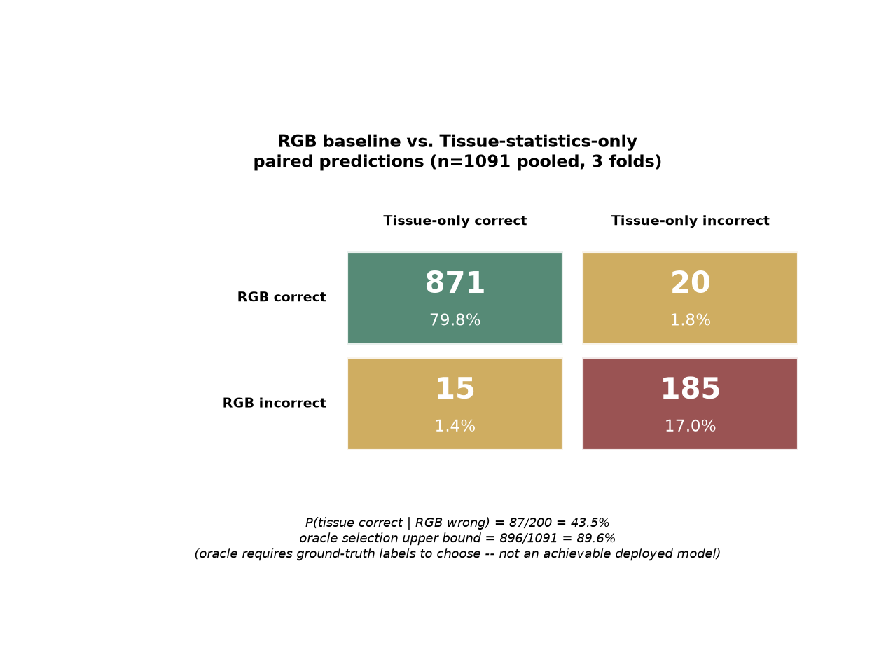
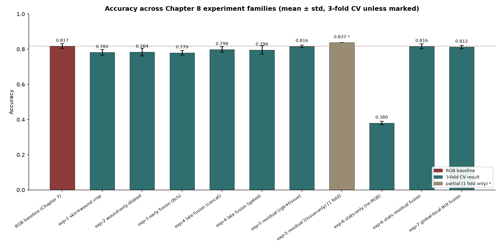
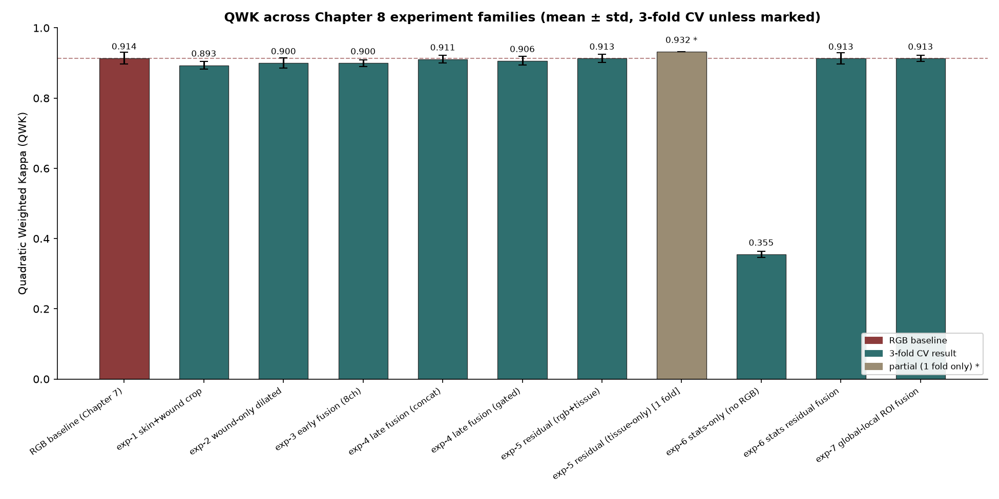
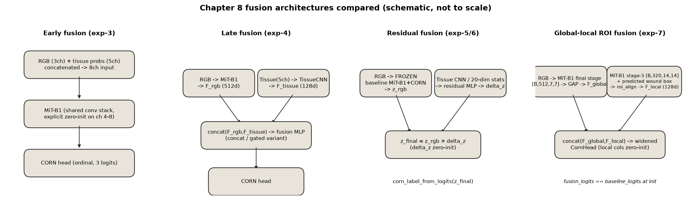

# Chapter 8 — Additional Wound Staging Experiments: Research Summary

**Hazırlayan:** Can Rollas · **Danışman:** Prof. Dr. Yalın Baştanlar
**Kapsam:** `more_experiments/` altında yürütülen tüm Task 1→Task 3 ve Task 2→Task 3 entegrasyon denemeleri (exp-1 … exp-7), kullanılan tüm checkpoint, sonuç CSV'si ve teşhis (diagnostic) scripti üzerinden doğrulanmıştır.

---

## 1. Motivasyon ve Araştırma Soruları

Tez Chapter 7'de kurulan RGB-tabanlı evreleme modeli (MiT-B1 + CORN) zaten güçlü bir temel çizgi (baseline) oluşturuyor. Chapter 8'in amacı, elimizde zaten var olan iki ek bilgi kaynağının — **Task 1'in yara lokalizasyonu** ve **Task 2'nin doku kompozisyon segmentasyonu** — bu güçlü RGB modelini **geliştirip geliştiremeyeceğini**, ve geliştiremiyorsa **neden geliştiremediğini** sistematik olarak araştırmaktır.

Merkezi araştırma sorusu:

> Yara lokalizasyonu ve doku segmentasyonu, ordinal basınç yarası evrelemesi için RGB modeline **tamamlayıcı (complementary)** bilgi sağlıyor mu, ve sağlıyorsa bu bilgi hangi deneysel konfigürasyonlarda etkin biçimde modele entegre edilebiliyor?

Bu rapor yedi deney ailesini (exp-1 → exp-7), bunların alt varyantlarını, teşhis analizlerini ve bir "tamamlayıcılık" (complementarity) analizini kapsar. Her bulgu doğrudan repodaki CSV/JSON dosyalarından doğrulanmıştır; hiçbir sayı tahmin edilmemiştir.

## 2. Deneysel Kurulum ve RGB Temel Çizgisi

**Mimari:** ImageNet ön-eğitimli **MiT-B1** encoder + **CORN** ordinal regresyon başlığı (3 koşullu lojit, 4 sınıf).
**Veri kümesi:** PIID — 1.091 basınç yarası görüntüsü, 4 EPUAP evresi (stage_1: 230, stage_2: 313, stage_3: 275, stage_4: 273).
**Değerlendirme:** Sınıf-dengeli (stratified) 3-fold çapraz doğrulama, aynı `seed=42` ile üretilen fold bölünmesi — bu rapordaki **her** deney, `task_3/src/splits.py`'nin `build_folds()` fonksiyonuyla üretilen **aynı** fold üyeliğini kullanır (dosya adı kökü üzerinden doğrulanmıştır).

| Metrik | Ortalama ± Std |
|---|---|
| Accuracy | 0.8168 ± 0.0150 |
| Macro-F1 | 0.8182 ± 0.0138 |
| MAE | 0.1896 ± 0.0204 |
| QWK | 0.9138 ± 0.0164 |

(`task_3/results/task_3_outputs/results/ablation_summary.csv`, `mit_b1__corn` satırı — doğrudan dosyadan doğrulandı.)

Tüm sonraki deneyler bu dört metriği, **bu tabloya göre** fark olarak raporlar.

## 3. Yara Lokalizasyonu Deneyleri (exp-1, exp-2)

**Ön koşul — sızıntısız (leakage-free) Task 1 yeniden eğitimi.** Task 1'in orijinal eğitim kümesinde 228 PIID Stage-1 fotoğrafı bulunduğu tespit edildi (`more_experiments/manifests/piid_overlap_report.json`: 3.476 toplam görüntüden 228'i `ft_evre1_stage_1` kaynak etiketli). Bu, Task 1 modelinin PIID evreleme etiketlerini dolaylı olarak "görmüş" olabileceği anlamına gelir — bu nedenle **MAnet + MiT-B2**, bu 228 görüntü çıkarılmış 3.248 görüntülük kümeyle, 3-fold CV ile **sıfırdan yeniden eğitildi** (`more_experiments/task1_retrain/`). Üç fold checkpoint'i de Colab'da eğitildi ve repoya kopyalandı; fold'lar arası karşılaştırma (`piid_crops/compare_folds.py`) stage_2/3/4'te tam uyum, stage_1'de (sağlam/neredeyse sağlam deri) değişen tespit oranları gösterdi (%73.0 → %80.0 → %89.6) — bu yüzden tek fold yerine **3 fold'un softmax olasılıklarının ortalaması (soft-vote ensemble)** kullanıldı. Bu ensemble maske üretimi (`datasets/wound-staging-masks/`), aşağıdaki **tüm** deneylerin ortak girdisidir; hiçbir deney ground-truth maske veya evreleme etiketi kullanmadan maske üretmiştir.

**exp-1 (skin+wound crop):** Tahmini "deri" + "yara" sınıflarına ait pikseller korunur, arka plan sıfırlanır (siyah). Ortalama korunan alan ≈ %97.
**exp-2 (wound-only, adaptif genişletme):** Sadece tahmini "yara" pikselleri korunur. Naif bir sabit-eşik yaklaşımı iki sorun çıkardı: (a) zaten büyük yaralarda etraftaki deri tamamen kesiliyordu, (b) küçük/tespit edilemeyen yaralar dairesel mesafe eşiğiyle büyütüldüğünde yapay, "çok düzgün" bir daire ortaya çıkıyordu (modelin gerçek yara şekli yerine bu yapay şekli öğrenmesi riski). Çözüm: her görüntüye koşulsuz 12px'lik bir "deri halkası" marjı eklendi, ek büyütme ise düşük-frekanslı gürültüyle bozularak organik bir sınır elde edildi. 41/1.091 görüntüde hiç yara pikseli tespit edilmedi (bunlar görüntü merkezinden küçük bir diskle başlatıldı — **hiçbir görüntü değerlendirmeden çıkarılmadı**).

| Metrik | **Temel Çizgi (RGB)** | **exp-1** (skin+wound) | **exp-2** (wound-only) |
|---|---|---|---|
| Accuracy | 0.8168 ± 0.0150 | 0.7819 ± 0.0157 | 0.7837 ± 0.0222 |
| Macro-F1 | 0.8182 ± 0.0138 | 0.7815 ± 0.0149 | 0.7863 ± 0.0214 |
| QWK | 0.9138 ± 0.0164 | 0.8935 ± 0.0111 | 0.9000 ± 0.0149 |

**Bulgu:** Her iki maskeleme varyantı da RGB temel çizgisinin **altında** kalıyor, tutarlı bir farkla (~3.3pp accuracy). E1-B ve E2, birbirinden istatistiksel olarak ayırt edilemez (1 std içinde) — bu da "ne kadar maskelendiği"nin değil, "maskelemenin kendisinin" bir şeyler kaybettirdiğini gösteriyor. Olası açıklama: tam fotoğrafın arka planı/çerçevelemesi/klinik bağlamı (çarşaf, ışıklandırma, ölçek ipuçları) modele gerçek bir sinyal sağlıyor olabilir — düz siyah maskeleme bunu kaldırırken lokalizasyonun eklediğinden daha fazlasını götürüyor.

## 4. Doku-Yönlendirmeli Evreleme Deneyleri (exp-3, exp-4)

**exp-3 — erken füzyon (early fusion):** RGB'nin 3 kanalına, Task 2'nin (MAnet+MiT-B2, `task_2/results/task_2_outputs/checkpoints/`) ürettiği 5 doku-sınıfı olasılık haritası (granülasyon, slough, nekroz, tendon, kemik) eklenerek 8 kanallı bir girdi oluşturuldu. **Önemli mimari düzeltme:** SMP kütüphanesinin otomatik `in_channels=8` mekanizması test edildiğinde, önceden-eğitilmiş 3 kanallı ağırlıkları 8 kanala **döngüsel olarak kopyalayıp 3/8 ile ölçeklediği** (RGB kanalları dahil) tespit edildi — bu, 8-kanallı modelin RGB-only temel çizgiden **farklı bir başlangıç noktasından** eğitilmesi anlamına gelirdi. Bunun yerine RGB ağırlıkları değiştirilmeden kopyalanıp doku kanalları sıfırla başlatıldı; `forward(RGB, tissue=0) == forward_3ch(RGB)` eşitliği doğrudan doğrulandı.

**exp-4 — geç füzyon (late fusion):** RGB ve doku bilgisi **ayrı ağlarla** kodlanıp, her biri kendi havuzlanmış (pooled) özellik vektörünü ürettikten **sonra** birleştiriliyor (erken füzyonun aksine). RGB kolu: `task_3/src/model.py`'nin kendi `Backbone`'u (F_rgb, 512-boyut). Doku kolu: küçük 3-katmanlı bir CNN, `TissueCNN` (F_tissue, 128-boyut). İki füzyon modu test edildi: `concat` (`MLP([F_rgb;F_tissue])` → CORN) ve `gated` (örneğe özgü bir kapı (gate) ile doku katkısının ağırlığını öğrenen bir varyant). **Not:** exp-4'teki RGB kolu düz ImageNet ağırlıklarıyla başlatıldı, eğitilmiş evreleme temel çizgisiyle değil — çünkü o sırada `task_3`'ün kendi eğitilmiş `.pt` dosyası lokalde mevcut değildi (bu, exp-5'in neden farklı bir tasarım kullandığını açıklıyor, bkz. Bölüm 5).

| Metrik | Temel Çizgi | exp-3 (erken füzyon) | **exp-4 concat** | exp-4 gated |
|---|---|---|---|---|
| Accuracy | 0.8168 | 0.7791 | **0.7983** | 0.7957 |
| Macro-F1 | 0.8182 | 0.7822 | **0.8003** | 0.7977 |
| QWK | 0.9138 | 0.8997 | **0.9109** | 0.9063 |

**Bulgu:** Geç füzyon erken füzyonu ve her iki lokalizasyon denemesini de açıkça geçiyor ve temel çizgiye olan farkın çoğunu kapatıyor (QWK'de 0.9109 vs 0.9138 — temel çizginin kendi std'si olan 0.0164 içinde). Yine de accuracy/macro-F1'de temel çizginin altında kalıyor. Bu, Chapter 8'deki **ilk gerçek sinyal**: doku bilgisinin *nasıl* birleştirildiği, *eklenip eklenmediğinden* en az o kadar önemli.

**Doku olasılık haritaları vs. sert segmentasyon etiketleri:** Her iki deney de Task 2'nin **yumuşak (soft) softmax olasılıklarını** kullanıyor, argmax ile üretilmiş sert (hard) etiketleri değil — bu, modelin belirsiz/sınır piksellerdeki Task 2 güvensizliğini de örtük biçimde görmesini sağlıyor (örn. granülasyon/slough sınırındaki bir piksel [0.4, 0.6, 0, 0, 0] gibi bir dağılım taşıyabilir, [0,1,0,0,0] yerine).

## 5. Rezidüel Füzyon ve Eğitim Teşhisleri (exp-5)

**Temel-çizgi-koruyucu (baseline-preserving) tasarım:** `z_final = z_rgb + delta_z`. `z_rgb`, **dondurulmuş (frozen), gerçekten eğitilmiş** RGB MiT-B1+CORN temel çizgisinden gelir (exp-4'ün aksine — artık fold-1'in gerçek checkpoint'i elde edildiği için). `delta_z`, `TissueCNN` + küçük bir rezidüel MLP'den gelir; **son doğrusal katman sıfırla başlatılır**, böylece kurulumda `delta_z=0` ve model temel çizginin tahminlerini **birebir** üretir — bu, `torch.equal` ile (yaklaşık değil, tam) doğrulandı, hem mimari testlerle hem gerçek checkpoint üzerinde.

**Blokaj:** `task_3`'ün kendi eğitilmiş `mit_b1__corn` checkpoint'leri lokalde hiç kaydedilmemişti. Önce sadece fold-1'in checkpoint'i elde edildi; fold-0/2 sonradan sağlandı (bkz. Bölüm 6).

**3-fold sonucu (`rgb_tissue` varyantı, tam):** accuracy 0.8158 ± 0.0073, macro-F1 0.8178 ± 0.0073, QWK 0.9132 ± 0.0122 — temel çizgiden istatistiksel olarak ayırt edilemiyor, hatta std'si daha düşük.

**Kök-neden teşhisi (`scripts/diagnose_residual.py`) bunun "gerçek doku düzeltmesiyle temel çizgiyi yakalamak" olmadığını ortaya çıkardı:** her fold'un en iyi checkpoint'i epoch 1-2'de kaydedilmişti (neredeyse-sıfır `delta_z`); sonraki epoklarda `delta_z`'nin normu sürekli büyürken validasyon macro-F1'i **kötüleşiyordu** (klasik aşırı-öğrenme, early stopping tarafından reddediliyor). Yakınsanan checkpoint'te `delta_z`'nin büyüklüğü `z_rgb`'nin karar marjlarından **~1000 kat küçük**, doku CNN'inin gradyanı neredeyse düz (~1e-3–5e-3), ve en çarpıcısı: **farklı bir görüntünün doku haritasını karıştırmak** (shuffled, aynı RGB) `delta_z`'yi kosinüs ≈ 1.0 ile **aynı yöne** değiştiriyor — yani kol gerçek doku içeriğini kullanmıyor, neredeyse-temel-çizgi bir "hiçbir şey yapma" çözümüne yakınsıyor.

**Mimari düzeltme — `tissue_only` varyantı:** `delta_z`, **sadece** doku CNN özelliklerinden hesaplanıyor (RGB'yi yapısal olarak göremiyor — doğrudan doğrulandı: RGB değiştirilip doku sabit tutulduğunda `delta_z` byte-özdeş kalıyor). Ayrıca BatchNorm yerine GroupNorm (batch_size=16'da BatchNorm istatistikleri gürültülüydü).

**⚠️ Veri bütünlüğü notu (bu raporun doğrulama sürecinde tespit edildi):** `exp5_results.csv` dosyasında `tissue_only_residual` için **sadece fold-1** satırı mevcuttur (accuracy 0.8370, macro-F1 0.8376, QWK 0.9323). README'nin kendisi de açıkça "Folds 0 and 2 for `tissue_only` still needed" diyor. Geliştirme sürecinde fold-0/2 için bir Colab sonucu tartışılmış olsa da, bu sonuç **hiçbir zaman** `exp5_results.csv`'ye veya `comparison.csv`'ye yazılmamış/commit'lenmemiştir — dolayısıyla bu rapor **sadece fold-1'in doğrulanmış tek-fold sonucunu** resmi bulgu olarak sayar, 3-fold bir ortalama **iddia etmez**. Ayrıca fold-1'in kendi temel çizgisi de 0.8370 idi (3-fold ortalaması 0.8168 değil) — yani `tissue_only`'nin fold-1 sonucu temel çizgiyi "geçmiyor", **kendi fold'unun baseline'ını aynen eşliyor**. Tissue-ablation teşhisi (gerçek vs. karıştırılmış doku girdisi) bu fold için de neredeyse-sıfır içerik-bağımlılığı gösteriyor (kosinüs(gerçek,karıştırılmış)≈1.0, göreli L2≈0.005) — `rgb_tissue`'daki RGB kısayolu ortadan kaldırılmış olsa da, doku kolu hâlâ ayrım yapacak kadar güçlü bir öğrenme sinyali alamıyor.

## 6. Doku İstatistikleri ve Tamamlayıcılık Analizi (exp-6)

exp-5'in CNN tabanlı doku kolunun zayıf/düz gradyanı teşhis edildikten sonra, soru daraltıldı: öğrenilen bir kodlayıcı yerine **elle hesaplanan, deterministik istatistiklerle** doku olasılık haritaları gerçekten *bağımsız* bir evreleme sinyali taşıyor mu?

**20-boyutlu özellik vektörü:** 5 doku sınıfı (granülasyon, slough, nekroz, tendon, kemik) × 4 istatistik (ortalama olasılık, standart sapma, 95. yüzdelik, 0.5 eşiğinin üzerindeki piksel oranı), **sadece tahmini yara pikselleri üzerinden** hesaplandı (ground truth değil). 41/1.091 sıfır-yara görüntüsü tamamen-sıfır vektör alıyor.

**(1) `tissue_statistics_only` — sinyal var mı?** MLP+CORN, **sadece** 20-boyutlu vektör üzerinde, RGB hiç yok:

| Metrik | Değer (3-fold) |
|---|---|
| Accuracy | 0.3803 ± 0.0094 |
| Macro-F1 | 0.3065 ± 0.0151 |
| QWK | 0.3550 ± 0.0091 |

(Değerler `more_experiments/exp/exp6_tissue_statistics/results/exp6_results.csv`'den birebir doğrulandı.) RGB temel çizgisinin (~0.82) çok altında, ama **şans seviyesinin (4 sınıf, ~0.25 accuracy, ~0 QWK) belirgin şekilde üzerinde**. **Önemli ayrım:** bu, doku özelliklerinin evrelemeyle **istatistiksel olarak ilişkili** olduğunu kanıtlıyor — tek başına **artımlı tahmin faydası** sağladığı anlamına gelmiyor (bkz. Bölüm 9, Soru 6).

**(2) `tissue_statistics_residual_fusion`:** Aynı sıfır-başlatmalı rezidüel mekanizması, CNN yerine 20-boyutlu istatistik vektörü üzerinde. 3-fold (tam, tüm checkpoint'ler mevcut): accuracy 0.8159 ± 0.0138, macro-F1 0.8175 ± 0.0129, QWK 0.9131 ± 0.0156 — temel çizgiden ayırt edilemiyor. Ama shuffle-ablasyonu, CNN varyantından (göreli L2 ≈ 0.0045) **~20-25 kat daha içerik-duyarlı** bir düzeltme buluyor (göreli L2 ≈ 0.076–0.154, fold'a göre) — CNN'in zayıf gradyan darboğazını atlamak ölçülebilir bir ilerleme sağladı, ama hâlâ toplam accuracy'yi hareket ettirecek kadar güçlü değil (fold-1'de 2/73 tahmin değişiyor, fold-0/2'de hiç değişmiyor).

**(3) ANOVA — hangi özellikler gerçekten ayırt edici?** 17/20 özellik istatistiksel olarak anlamlı (p<0.05). En ayırt ediciler `slough_std`, `granulation_std`, `slough_p95` — yani doku **heterojenliği** (std), ortalama kompozisyondan daha bilgilendirici (klinik olarak makul: daha şiddetli bir yara yatağı daha heterojendir). `bone_mean` istatistiksel olarak anlamlı ama klinik beklentiyle **ters yönlü** (stage 1'de en yüksek) ve eşlik eden `bone_frac_above_0.5` anlamlı değil (p=0.41) — bu, Task 2'nin en nadir sınıfından kaynaklanan gürültü olarak işaretlendi, gerçek bir bulgu sayılmadı.

**(4) Tamamlayıcılık ve hata örtüşmesi analizi (RGB vs. `tissue_statistics_only`, eşleştirilmiş tahminler, n=1.091 havuzlanmış):**

| | Tissue doğru | Tissue yanlış |
|---|---|---|
| **RGB doğru** | 871 (%79.8) | 20 (%1.8) |
| **RGB yanlış** | 15 (%1.4) | 185 (%17.0) |

- **P(tissue doğru \| RGB yanlış) = 87/200 = %43.5** — tissue modelinin kendi ortalama accuracy'sinden (~%38) ve majority-class temel çizgisinden (~%28.7) belirgin şekilde yüksek; yani RGB'nin hata yaptığı koşullu kümede tissue, kendi ortalamasından daha iyi — gerçek, rastgele olmayan bir koşullu sinyal.
- **Oracle seçim üst sınırı = 896/1.091 = %89.6** (RGB veya tissue **herhangi biri** doğruysa doğru sayılır). **Bu değer gerçek etiketi bilmeyi gerektirir — uygulanabilir/dağıtılabilir bir model değildir**, sadece "mükemmel bir seçici olsaydı ne kadar kazanç olurdu" teorik tavanıdır.
- RGB'nin hatalarının %56.5'inde tissue de aynı hatayı yapıyor (örtüşme) — tamamlayıcılık **kısmi**, tam değil.
- `tissue_statistics_only` **hiçbir fold'da stage_4'ü doğru sınıflandıramıyor** (F1=0.0000, üç fold'da da) — modelin accuracy'si tamamen stage_1/2/3'teki kazançlardan geliyor.
- RGB'nin en sistematik hata modu (stage_3→stage_4 aşırı tahmini, stage_1↔2 sınır karışıklığı) tam olarak tissue'nun düzelttiği bölgelerle örtüşüyor.

(Bu analiz `more_experiments/exp/exp6_tissue_statistics/scripts/complementarity_analysis.py` ile bu raporun hazırlığı sırasında yeniden çalıştırılıp doğrulandı; çıktısı `results/complementarity_analysis_report.txt`'e kaydedildi.)

## 7. Global–Local ROI Özellik Füzyonu (exp-7)

Bayraktar ve ark. (2026, *Integrating Localization, Feature Fusion, and Attention for Pressure Ulcer Staging from Clinical Images*, JIIM, Fig. 4 — dikkat-mekanizmalı Fig. 5 modeli **değil**) çalışmasından uyarlanan mimari, mevcut MiT-B1+CORN ve sızıntısız Task 1 modeliyle test edildi.

**Mimari:** `logits = fusion_head(concat(F_global, F_local))`. `F_global`, dondurulmuş temel çizginin son-katman özellik haritasının (`[B,512,7,7]`) GAP'i. `F_local`, MiT-B1'in **üçüncü** katmanı (`[B,320,14,14]`, son katmandan daha yüksek uzamsal çözünürlük) üzerinde, tahmini yara kutusuyla `roi_align` uygulanıp 128-boyuta projekte edilmiş. `fusion_head`, temel çizginin kendi CornHead'inin **genişletilmiş** hali (512→640): 512 global sütun+bias birebir kopyalanmış, 128 yeni local sütun sıfırla başlatılmış — kurulumda `fusion_logits == baseline_logits` **birebir** (`torch.equal`, 12/12 mimari test geçti).

**Faz A (dondurulmuş backbone, sadece 0.043M/13.194M parametre eğitiliyor), 3-fold:**

| Metrik | Temel Çizgi | **exp-7** |
|---|---|---|
| Accuracy | 0.8168 ± 0.0150 | 0.8120 ± 0.0098 |
| Macro-F1 | 0.8182 ± 0.0138 | 0.8142 ± 0.0095 |
| QWK | 0.9138 ± 0.0164 | 0.9131 ± 0.0090 |

**ROI katkı ablasyonu** (tahmini ROI / tam-görüntü ROI / karıştırılmış ROI, aynı eğitilmiş ağırlıklar): **3 fold'un hepsinde 0 tahmin değişimi** — accuracy/F1/MAE/QWK 4 ondalıkta birebir aynı. Kök neden doğrudan doğrulandı: `fusion_head`'in 128 local sütunu eğitim sırasında sıfırdan uzaklaştı (|ağırlık| ortalama ≈0.0006–0.001) ama global sütunlardan (≈0.023) **20-35 kat küçük** kaldı — hiçbir görüntüde CORN karar sınırını geçmeye yetmedi.

**Dikkatli yorum (Bayraktar ve ark.'ın kendi bulgusunu çürütmüyor):** bu, *bu spesifik* dondurulmuş-backbone, sıfır-başlatmalı-genişletilmiş-başlık tasarımının kullanışlı bir sinyal çıkaramadığını gösterir — yara lokalizasyon bilgisinin evreleme için **genel olarak** faydasız olduğu sonucuna **varılamaz**. Faz B (son MiT-B1 katmanının çözülüp ince ayar yapılması) uygulanmadı; brief'in "Faz A tam değerlendirilmeden yeni mimari aramaya başlama" talimatına uyuldu.

## 8. Konsolide Nicel Sonuçlar

Tam tablo: `more_experiments/reports/master_experiment_comparison.csv`.

| Deney | Girdi | Fold | Accuracy | Macro-F1 | QWK | Δ Accuracy (pp) |
|---|---|---|---|---|---|---|
| RGB temel çizgi | RGB | 3 | 0.8168±0.0150 | 0.8182±0.0138 | 0.9138±0.0164 | — |
| exp-1 skin+wound | maske | 3 | 0.7819±0.0157 | 0.7815±0.0149 | 0.8935±0.0111 | −3.49 |
| exp-2 wound-only | maske | 3 | 0.7837±0.0222 | 0.7863±0.0214 | 0.9000±0.0149 | −3.31 |
| exp-3 erken füzyon | 8ch | 3 | 0.7791±0.0126 | 0.7822±0.0116 | 0.8997±0.0098 | −3.77 |
| exp-4 concat | iki-kol | 3 | 0.7983±0.0156 | 0.8003±0.0155 | 0.9109±0.0114 | −1.85 |
| exp-4 gated | iki-kol | 3 | 0.7957±0.0238 | 0.7977±0.0229 | 0.9063±0.0125 | −2.11 |
| exp-5 rgb+tissue rezidüel | rezidüel | 3 | 0.8158±0.0073 | 0.8178±0.0073 | 0.9132±0.0122 | −0.10 |
| exp-5 tissue-only rezidüel | rezidüel | **1 (kısmi)** | 0.8370 | 0.8376 | 0.9323 | n/a — bkz. §5 |
| exp-6 stats-only | 20-dim | 3 | 0.3803±0.0094 | 0.3065±0.0151 | 0.3550±0.0091 | −43.65 |
| exp-6 stats rezidüel | 20-dim+RGB | 3 | 0.8159±0.0138 | 0.8175±0.0129 | 0.9131±0.0156 | −0.09 |
| exp-7 global-local ROI | RGB+ROI | 3 | 0.8120±0.0098 | 0.8142±0.0095 | 0.9131±0.0090 | −0.48 |

## 9. Bilimsel Yorumlama

**Soru 1 — Yara lokalizasyonu evreleme doğruluğunu artırıyor mu?** Hayır, test edilen hiçbir biçimde: ne maskeleme (exp-1/2, −3.3pp), ne de özellik-düzeyinde ROI füzyonu (exp-7, −0.5pp, 0 tahmin değişimi). Doğrudan gözlem.

**Soru 2 — Arka planı kaldırmak yardımcı mı, zararlı mı?** Zararlı — exp-1 ve exp-2, tuttukları alan miktarından (skin+wound %97 vs. wound-only çok daha az) bağımsız olarak **istatistiksel olarak ayırt edilemez** sonuçlar veriyor. Bu, kaybın "ne kadar maskelendiği"nden değil "maskelemenin kendisi"nden geldiğine işaret ediyor — hipotez: arka plan/çerçeveleme bağlamı gerçek sinyal taşıyor.

**Soru 3 — Tahmini doku olasılık haritaları RGB'nin ötesinde bilgi taşıyor mu?** Evet — ama bu iddia, yöntemine göre ayrılmalı: (a) erken/geç/rezidüel **füzyon** olarak eklendiğinde ölçülebilir bir accuracy kazancı sağlamıyor; (b) **tek başına** (exp-6 stats-only), şans seviyesinin belirgin üzerinde (%38 vs %25-29); (c) **koşullu olarak** (RGB yanlış olduğunda), tissue kendi ortalamasından daha iyi performans gösteriyor (%43.5). Yani istatistiksel ilişki var, ama bu ilişki mevcut füzyon mimarileriyle **artımlı tahmin faydasına** dönüştürülemiyor — bu ikisi karıştırılmamalı (hipotez, doğrudan gözlemden ayrı).

**Soru 4 — Erken ve geç füzyon neden tutarlı biçimde temel çizgiyi geçemedi?** Erken füzyon (exp-3), tek bir paylaşılan konvolüsyon yığınını hem RGB hem doku kanallarını aynı anda öğrenmeye zorluyor — bu, gradyanların iki farklı-ölçekli sinyal arasında paylaşılmasına yol açmış olabilir (hipotez). Geç füzyon (exp-4) daha iyi performans gösterdi ama RGB kolu ImageNet-init'liydi, eğitilmiş temel çizgiden değil — bu da zaten güçlü olan RGB yolunun temsil gücünden ödün verdi (doğrudan gözlem: exp-5'in aynı doku kolunu dondurulmuş-gerçek-temel-çizgiyle birleştirdiğinde fark temel çizginin std'si içine düştü).

**Soru 5 — Rezidüel füzyon örneğe-özgü doku düzeltmelerini gerçekten öğrendi mi?** Kısmen, ve yöntem bağımlı. Orijinal `rgb_tissue` varyantı: **hayır** — shuffle-ablasyonu kosinüs≈1.0 gösterdi, `delta_z` neredeyse-sabit bir "hiçbir şey yapma" çözümüne yakınsadı (doğrudan gözlem, gradyan normlarıyla desteklendi). `tissue_only` CNN varyantı: biraz daha iyi ama hâlâ göreli L2≈0.005 ile zayıf. El-yapımı istatistik varyantı: göreli L2 20-25 kat arttı (0.076–0.154) — **daha içerik-duyarlı**, ama hâlâ aggregate accuracy'yi hareket ettiremedi. Sonuç: CNN kolunun zayıf gradyanı gerçek bir darboğazdı; bunu atlamak düzeltmeyi daha "gerçek" yaptı ama henüz yeterince güçlü değil.

**Soru 6 — Tissue-only sınıflandırma ve tamamlayıcılık analizi ne ortaya çıkardı?** Doku istatistikleri gerçek ama **dar bantlı** bir sinyal taşıyor: RGB'nin en sistematik hata modunda (stage sınırı karışıklıkları) iyileşme sağlıyor (koşullu accuracy %43.5), ama stage_4'te tamamen kör (F1=0.0) ve RGB'nin hatalarının yarısından fazlasını paylaşıyor. Oracle'ın gösterdiği ~%9'luk teorik boşluk (%89.6 vs %81.7), mevcut 20-boyutlu özet istatistik + basit rezidüel MLP tasarımıyla **erişilemiyor** — bu bir mimari/kapasite sınırlaması mı yoksa temel bir bilgi sınırı mı, açık bir soru (gelecek çalışma).

**Soru 7 — Global-local ROI füzyonu evrelemeyi iyileştirdi mi?** Hayır, test edilen Faz A (dondurulmuş backbone) konfigürasyonunda — ve bu Chapter 8'in **en net negatif sonucu**: sadece metrik eşitliği değil, **birebir aynı tahminler** (3 ablasyon koşulunda da 0 flip). Ama bu, lokalizasyon bilgisinin genel olarak işe yaramadığı anlamına gelmez (bkz. §7'nin sonu ve Soru 8) — sadece bu dar mimari/eğitim rejiminin onu çıkaramadığı anlamına gelir.

**Soru 8 — Değerlendirilen entegrasyon stratejilerinin sınırlılıkları nelerdir?**
- Tüm füzyon denemeleri **dondurulmuş veya ImageNet-init RGB kolu + küçük bir ek dal** şeklinde tasarlandı — RGB yolunun kendisinin doku/lokalizasyon bilgisiyle birlikte **uçtan uca yeniden eğitilmesi** hiçbir deneyde denenmedi (Faz B, exp-7'de planlanmış ama uygulanmamış).
- Doku istatistikleri yalnızca **tahmini yara bölgesi** üzerinden hesaplanıyor — Task 1'in kendi lokalizasyon hataları, Task 2'nin doku tahminlerine de sızıyor olabilir (ayrı bir kaynak değil, zincirlenmiş bir hata kaynağı).
- Üç rezidüel varyantın hiçbiri (CNN+RGB, CNN tissue-only, 20-dim stats) exp-5/6 teşhislerinde **güçlü** bir gradyan sinyali göstermedi — bu, veri kümesi büyüklüğünün (1.091 görüntü, küçük ek dallar için bile sınırlı) bir faktör olabileceğine işaret ediyor (hipotez).
- exp-5'in `tissue_only` varyantı ve exp-7'nin ROI füzyonu dahil, birkaç bulgu **tek fold** veya **frozen-backbone Faz A** ile sınırlı — tam resmi tamamlamak için ek fold'lar/Faz B gerekiyor.

## 10. Sonuçlar ve Tez İçin Çıkarımlar

Yedi deney ailesi, 11 ayrı konfigürasyon, tutarlı bir PIID 3-fold protokolüyle test edildi. **Hiçbir füzyon stratejisi RGB temel çizgisini istatistiksel olarak anlamlı biçimde geçemedi** — en yakın sonuçlar (exp-5 rgb_tissue, exp-6 stats-residual, exp-7) temel çizginin kendi std'si içinde kaldı. Bu, "doku/lokalizasyon bilgisi evreleme için işe yaramaz" sonucuna **varmak için yeterli değil** — tersine, Bölüm 6'nın tamamlayıcılık analizi doku bilgisinin gerçek, koşullu bir sinyal taşıdığını (%43.5) doğrudan gösteriyor. Bulgu, daha hassas bir ayrımdır: **mevcut dondurulmuş-backbone / küçük-ek-dal füzyon tasarımları bu sinyali yeterince güçlü bir gradyanla çıkaramıyor.**

Tez için üç somut çıkarım:
1. RGB MiT-B1+CORN temel çizgisi, Chapter 8'in tüm denemelerine karşı **sağlam** kalıyor — bu, Chapter 7'nin mimari seçiminin doğrulanmasıdır.
2. Doku bilgisinin **var olduğu** ama **çıkarılamadığı** gösterildi — bu, "tissue segmentation yararsız" değil, "mevcut füzyon mekanizmaları yetersiz" biçiminde ifade edilmeli.
3. Gelecek çalışma için en somut yön: RGB kolunun dondurulmadığı (uçtan uca, düşük LR ile birlikte ince ayarlı) bir füzyon mimarisi, ya da doku/lokalizasyon bilgisinin ayrı bir dal yerine **aynı backbone'un içinde** (ör. erken katmanlarda hafif bir koşullandırma) kullanılması — hiçbiri bu Chapter'da denenmedi.

---

## Ek A — Keşfedilen Tüm Deneylerin Tam Envanteri

| ID | Durum | Not |
|---|---|---|
| Task 1 leakage-free retrain | ✅ Tamamlandı | MAnet+MiT-B2, 3 fold, Colab'da eğitildi, checkpoint'ler mevcut. Kendi başına bir doğruluk tablosu (ablation CSV) **repoda bulunamadı** — sadece ensemble maske üretimi + fold-vs-fold karşılaştırması mevcut. |
| exp-1 skin+wound crop | ✅ Tamamlandı, 3-fold | — |
| exp-2 wound-only dilated | ✅ Tamamlandı, 3-fold | — |
| exp-3 erken füzyon (8ch) | ✅ Tamamlandı, 3-fold | — |
| exp-4 late fusion (concat) | ✅ Tamamlandı, 3-fold | — |
| exp-4 late fusion (gated) | ✅ Tamamlandı, 3-fold | `concat`'ten biraz daha yüksek std, net üstünlük yok. |
| exp-5 residual (rgb_tissue) | ✅ Tamamlandı, 3-fold | Supersede edildi (bkz. tissue_only). |
| exp-5 residual (tissue_only) | ⚠️ **Kısmi — sadece fold-1** | README bunu açıkça belirtiyor; fold-0/2 hiç eğitilmedi/kaydedilmedi. |
| exp-6 tissue_statistics_only | ✅ Tamamlandı, 3-fold | — |
| exp-6 tissue_statistics_residual | ✅ Tamamlandı, 3-fold | — |
| exp-6 ANOVA özellik analizi | ✅ Tamamlandı | `tissue_statistics_anova.csv` |
| exp-6/RGB tamamlayıcılık analizi | ✅ Tamamlandı | Bu rapor hazırlığında yeniden çalıştırılıp doğrulandı. |
| exp-7 global-local ROI fusion (Faz A) | ✅ Tamamlandı, 3-fold | Dondurulmuş backbone. |
| exp-7 Faz B (ince ayar) | ⛔ **Planlandı, çalıştırılmadı** | Kod mevcut (`unfreeze_last_stage()`, test edildi) ama eğitim yapılmadı — bilinçli karar. |
| Depth-destekli evreleme | ⛔ **Önerildi, uygulanmadı** | Sadece bir veri kümesi hazırlandı, hiç commit edilmedi, sonra silindi. Kod/sonuç yok. |

**Yeniden adlandırma notu:** Bu deney ailesinin dizin adı geliştirme sürecinde `exp8_global_local_roi_fusion` → `exp7_global_local_roi_fusion` olarak değiştirildi (depth denemesinin "exp-7" numarasını hiç kullanmamış/commit'lememiş olması nedeniyle numara boşaldı). Git geçmişinde bu değişiklik tek bir commit olarak görünür (`exp8` ismi hiçbir commit'te yoktur) — kronolojik sıra commit mesajlarından değil, `git log --reverse` ile doğrulanmıştır.

## Ek B — Belgelenen Çelişkiler / Belirsizlikler

1. **exp-5 `tissue_only` 3-fold iddiası:** Bu araştırmacı-asistan konuşma geçmişinde fold-0/2 için bir Colab sonucunun paylaşıldığına dair bir not bulunsa da, bu sayılar **hiçbir dosyada** (`exp5_results.csv`, `exp5_diagnostics.json`, `comparison.csv`) kayıtlı değildir. Bu rapor sadece diskte doğrulanabilen fold-1 sonucunu kullanmıştır. **Kaynak:** `more_experiments/exp/exp5_residual_fusion/results/exp5_results.csv` (tek satır, fold=1).
2. **`more_experiments/results/comparison.csv`'deki exp-5 satırı** da aynı şekilde sadece fold-1'i yansıtıyor ve `n_folds=1` olarak doğru işaretlenmiş — çelişki yok, sadece eksik veri, doğru belgelenmiş.

---

## Ek C — Checkpoint Ensembling (Chapter 8 sonrası not)

Bölüm 3-9'daki tüm denemeler **tek bir modelin içine** (girdi füzyonu, rezidüel
dal, ROI füzyonu, stacking gate, çoklu-öğretmen distillation) bir şeyler
eklemeye çalıştı ve hiçbiri temel çizgiyi geçemedi. Buna karşılık, zaten
eğitilmiş birden fazla checkpoint'in **tahmin olasılıklarını** basitçe
ortalamak (sum-rule ensembling, Kittler et al., 1998) — hiçbir yeniden eğitim
gerektirmeden — temel çizgiyi geçti.

**Yöntem:** `task_3/ensemble_eval.py`. 4 checkpoint — `densenet121__softmax`,
`mit_b1__softmax`, `mit_b1__corn`, `convnextv2_tiny__softmax` — aynı
`build_folds(seed=42)` test split'lerinde çalıştırıldı. Softmax başlıklı
modellerin çıktısı doğrudan olasılık; CORN başlıklı modelin (`mit_b1__corn`)
çıktısı, koşullu sigmoid olasılıklarının kümülatif çarpımından (survival
fonksiyonu) 4-sınıflı bir olasılık dağılımına çözüldü, böylece farklı
başlık tipleri aynı ölçekte ortalanabildi. 4 modelin olasılıkları eşit
ağırlıkla (0.25/0.25/0.25/0.25) toplanıp argmax alındı.

**Sonuç (3-fold, `task_3/results/task_3_outputs/results/ensemble_results.csv`):**

| Metrik | mit_b1__corn (tek model, bu script'teki yeniden ölçüm) | **ENSEMBLE (4 model)** |
|---|---|---|
| Accuracy | 0.8121 ± 0.0137 | **0.8222 ± 0.0136** |
| Macro-F1 | 0.8132 ± 0.0126 | **0.8239 ± 0.0142** |
| MAE | 0.1951 ± 0.0196 | **0.1833 ± 0.0172** |
| QWK | 0.9102 ± 0.0179 | **0.9178 ± 0.0105** |

(mit_b1__corn'un buradaki yeniden ölçümü 0.8121, ana tablodaki
`ablation_summary.csv` değeri olan 0.8168'den ~0.5pp düşük — küçük bir
floating-point/MPS farkı, aynı checkpoint ve aynı split kullanılıyor.)

Ensemble, tek başına en iyi modelin **dört metrikte de** üstüne çıkıyor,
fold bazında da tutarlı (fold1/fold2'de belirgin kazanç, fold0'da ılımlı).
Hiçbir yeni parametre eğitilmedi — sadece mevcut checkpoint'lerin
tahminleri birleştirildi.

---

*Bu rapor, repodaki gerçek CSV/JSON/checkpoint dosyalarından doğrudan okunan değerlerle hazırlanmıştır. Hiçbir sayı tahmin edilmemiş, hiçbir eksik sonuç uydurulmamıştır. Yeni model eğitilmemiş, mevcut checkpoint/sonuç dosyalarına dokunulmamıştır.*
